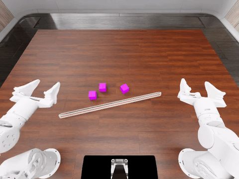
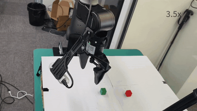

Install and evaluate the LiteArm SE dual-arm station on RoboDojo with a
PyRUA-Lean code policy, for engineers who need a reproducible setup of the
simulator, policy server and robot assets.

English | [简体中文](README.zh-CN.md)

# LiteArm AI, PyRUA-Lean on RoboDojo

This repository contains both halves of the stack. The policy server writes
robot programs against the LiteArm tools; the RoboDojo client executes them in
Isaac Sim. It includes the LiteArm robot asset, environment configuration,
evaluation scripts and the data used for the official `stack_blocks` run. The
same PyRUA-Lean tree also carries the real-hardware path, which drives a
calibrated LiteArm / LiteGrip station without RoboDojo or Isaac Sim.

## Demo

`stack_blocks`, seed 0, on the reference machine:


Full video: [stack_blocks.mp4](docs/assets/videos/stack_blocks.mp4)

`cover_blocks`, seed 0:


Full video: [cover_blocks.mp4](docs/assets/videos/cover_blocks.mp4)

`align_blocks`, seed 0:



Full video: [align_blocks.mp4](docs/assets/videos/align_blocks.mp4)

Real hardware demo, LiteArm / LiteGrip station:



Full video: [litearm-pyrualean.mp4](docs/assets/videos/litearm-pyrualean.mp4)

The `stack_blocks` seed-0 evaluation completed with success rate 1.0 and score
100 after 1379 steps. The `align_blocks` seed-0 run on 2026-11-03 also returned
success rate 1.0 and score 100. The simulator ran on Ubuntu 22.04 with an RTX
4060 8 GB; the policy server ran on a Jetson AGX Thor 128 GB. The simulator
recordings are from reference-machine runs; the real-hardware recording is from
the LiteArm / LiteGrip station.

## What is included

| Path | Contents |
| --- | --- |
| `pyrua-lean/` | PyRUA-Lean source, including the LiteArm adapter and tools |
| `pyrua-lean/src/pyrualean/hardware/` | Real-hardware station service and agent adapter: configuration, calibration, planning, perception and RPC |
| `robodojo/` | RoboDojo source, including the LiteArm robot and environment configuration |
| `integrations/xpolicylab/` | Changes to the XPolicyLab submodule that are not in its upstream repository |
| `assets/litearm/` | LiteArm URDF, USD, collision/drive configuration and cuRobo template |
| `tools/litearm/` | Asset conversion, validation and diagnostic scripts |
| `scripts/` | Install, asset, evaluation and split-host scripts |
| `docs/` | Setup, usage and architecture notes |

## Requirements

- Ubuntu 22.04 on x86_64. Other Linux distributions are not verified.
- An NVIDIA GPU with a current driver. The simulator runs on 8 GB at the 160x120 camera resolution used here. SAM3, the policy server's segmentation model, needs another 5-6 GB, so use two hosts below 16 GB total, or one host with at least 16 GB.
- About 40 GB of disk for Isaac Sim and IsaacLab, plus tens of GB for the RoboDojo asset dataset and 3.4 GB for the SAM3 checkpoint.
- Conda or Miniconda, `git`, `git-lfs`, and `wget`.
- An OpenAI-compatible chat endpoint and an API key. No key is stored in this repository.

## Quick start on one machine

```bash
git clone https://github.com/YuyueZhou711/LiteARM-AI-PyRUA-Lean_hardware_adapted.git
cd LiteARM-AI-PyRUA-Lean_hardware_adapted
bash scripts/setup.sh
bash scripts/fetch_assets.sh
cp config/env.example.sh config/env.sh
# edit config/env.sh with your endpoint, key and model name
bash scripts/run_eval.sh --task stack_blocks --seed 0
```

`scripts/setup.sh` installs both conda environments and can take an hour or more
on a fresh host. Use `--skip-sim` on a policy-server host and `--skip-policy` on
a simulator host. The scripts encode the reference-machine steps; a fresh-host
run is not verified. See [Setup](docs/setup.md) for the verification status.

**Do not** commit `config/env.sh`, paste the key into an issue, or put it in a
script; the file is git-ignored.

## Split setup

Run these commands from the repository root on each host.

Policy server host:

```bash
bash scripts/setup.sh --skip-sim
bash scripts/fetch_assets.sh --policy-only
cp config/env.example.sh config/env.sh
# edit config/env.sh
bash scripts/run_server.sh
```

Simulator host:

```bash
bash scripts/setup.sh --skip-policy
bash scripts/fetch_assets.sh --skip-sam3
POLICY_HOST=192.168.1.10 bash scripts/run_client.sh
```

`scripts/fetch_assets.sh --policy-only` downloads only the SAM3 checkpoint. The
simulator host downloads the RoboDojo dataset and installs the LiteArm asset;
`--skip-sam3` keeps the checkpoint off that host.

## Real hardware

`pyrua-lean/src/pyrualean/hardware/` runs a calibrated LiteArm / LiteGrip
station directly: a device-side service owns the arms, grippers and cameras, and
an agent-side adapter exposes the same `robo` API. It does not import or start
RoboDojo and does not need Isaac Sim.

```bash
# Device host: the service owns the hardware; read-only is the default mode.
conda env create -f pyrua-lean/environments/litearm-device.yml
LITEARM_HW_CONFIG=/absolute/path/station.json \
  bash pyrua-lean/scripts/litearm_hardware_service.sh

# Agent host: run one episode (offline-fake needs no hardware).
LITEARM_HW_CONFIG=/absolute/path/station.json \
LITEARM_HW_MODE=offline-fake \
LITEARM_HW_INSTRUCTION='stack the blocks' \
  bash pyrua-lean/scripts/litearm_hardware_play.sh
```

Copy `pyrua-lean/configs/litearm_real.example.json` and
`pyrua-lean/configs/calibration/litearm_real.example.json` to local, git-ignored
files and measure the station before setting `execution.mode=live`. See [LiteArm
Real](pyrua-lean/docs/robots/litearm-real.md) for the station format, SDK
versions, service protocol and safety rules. The hardware path has no
task-success evaluator and deliberately writes no RoboDojo results.

## Documentation

- [Documentation index](docs/index.md)
- [Setup](docs/setup.md): prerequisites, installation, assets, verification.
- [Usage](docs/usage.md): model configuration, single and split evaluation.
- [Architecture](docs/architecture.md): components, data flow, upstream pins.
- [Real hardware](pyrua-lean/docs/robots/litearm-real.md): the LiteArm / LiteGrip station outside Isaac Sim.

## License

The repository's own license has not been decided. Bundled third-party
components keep their upstream licenses; see [NOTICE](NOTICE).
