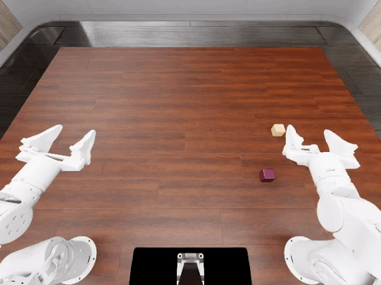
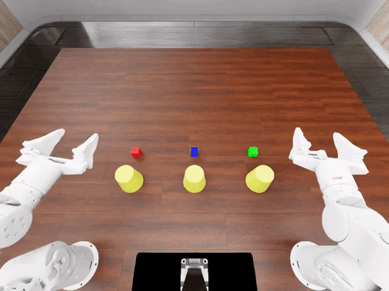

Install and evaluate the LiteArm SE dual-arm station on RoboDojo with a
PyRUA-Lean code policy.

# LiteARM AI, PyRUA-Lean on RoboDojo

This repository runs the LiteArm SE dual-arm station in the RoboDojo simulator
with a PyRUA-Lean code policy. The policy server writes robot programs against
the LiteArm tools; the RoboDojo client executes them in Isaac Sim. It is for
engineers who need a reproducible install of both halves of the stack, including
the LiteArm robot asset, environment configuration, evaluation scripts, and the
data used for the official `stack_blocks` run.

## Demo

`stack_blocks`, seed 0, on the reference machine:



Full video: [stack_blocks.mp4](docs/assets/videos/stack_blocks.mp4)

`cover_blocks`, seed 0:



Full video: [cover_blocks.mp4](docs/assets/videos/cover_blocks.mp4)

The `stack_blocks` seed-0 evaluation completed with success rate 1.0 and score
100 after 1379 steps. The simulator ran on Ubuntu 22.04 with an RTX 4060 8 GB;
the policy server ran on a Jetson AGX Thor 128 GB. The recordings above are from
those runs.

## What is included

| Path | Contents |
| --- | --- |
| `pyrua-lean/` | PyRUA-Lean source, including the LiteArm adapter and tools |
| `robodojo/` | RoboDojo source, including the LiteArm robot and environment configuration |
| `integrations/xpolicylab/` | Changes to the XPolicyLab submodule that are not in its upstream repository |
| `assets/litearm/` | LiteArm URDF, USD, collision/drive configuration and cuRobo template |
| `tools/litearm/` | Asset conversion, validation and diagnostic scripts |
| `scripts/` | Install, asset, evaluation and split-host scripts |
| `docs/` | Setup, usage and architecture notes |

## Requirements

- Ubuntu 22.04 on x86_64. Other Linux distributions are not verified.
- An NVIDIA GPU with a current driver. The simulator runs on 8 GB at the
  160x120 camera resolution used here. SAM3, the policy server's segmentation
  model, needs another 5-6 GB, so use two hosts below 16 GB total, or one host
  with at least 16 GB.
- About 40 GB of disk for Isaac Sim and IsaacLab, plus tens of GB for the
  RoboDojo asset dataset and 3.4 GB for the SAM3 checkpoint.
- Conda or Miniconda, `git`, `git-lfs`, and `wget`.
- An OpenAI-compatible chat endpoint and an API key. No key is stored in this
  repository.

## Quick start on one machine

```bash
git clone https://github.com/nexform-tech/LiteARM-AI-PyRUA-Lean.git
cd LiteARM-AI-PyRUA-Lean
bash scripts/setup.sh
bash scripts/fetch_assets.sh
cp config/env.example.sh config/env.sh
# edit config/env.sh with your endpoint, key and model name
bash scripts/run_eval.sh --task stack_blocks --seed 0
```

`scripts/setup.sh` installs both conda environments and can take an hour or more
on a fresh host. Use `--skip-sim` on a policy-server host and `--skip-policy` on
a simulator host.

## Split setup

Policy server host:

```bash
bash scripts/setup.sh --skip-sim
bash scripts/fetch_assets.sh --policy-only
cp config/env.example.sh config/env.sh
# edit config/env.sh
bash scripts/run_server.sh
```

Simulator host:

```bash
bash scripts/setup.sh --skip-policy
bash scripts/fetch_assets.sh --skip-sam3
POLICY_HOST=<policy-server-ip> bash scripts/run_client.sh
```

`scripts/fetch_assets.sh --policy-only` downloads only the SAM3 checkpoint. The
simulator host downloads the RoboDojo dataset and installs the LiteArm asset;
`--skip-sam3` keeps the checkpoint off that host.

## Documentation

- [Documentation index](docs/index.md)
- [Setup](docs/setup.md): prerequisites, installation, assets, verification.
- [Usage](docs/usage.md): model configuration, single and split evaluation.
- [Architecture](docs/architecture.md): components, data flow, upstream pins.

## Verified scope

The `stack_blocks` seed-0 result and the two recordings were produced with the
code in this repository on the reference machine. The install scripts encode the
steps that were used there; a fresh-host run of the scripts has not been
verified. GPU memory, driver version and endpoint behaviour are the most common
sources of differences.

## License

The repository's own license has not been decided. Bundled third-party
components keep their upstream licenses; see [NOTICE](NOTICE).
