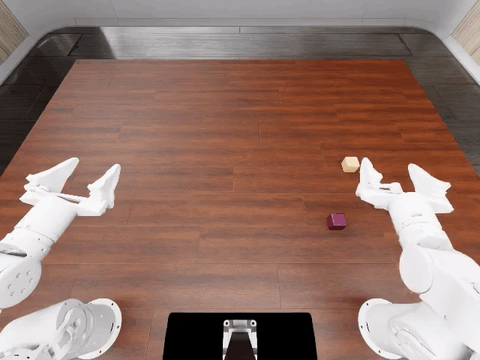
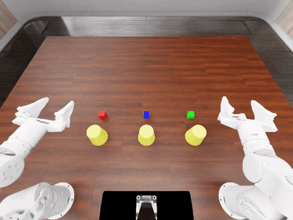
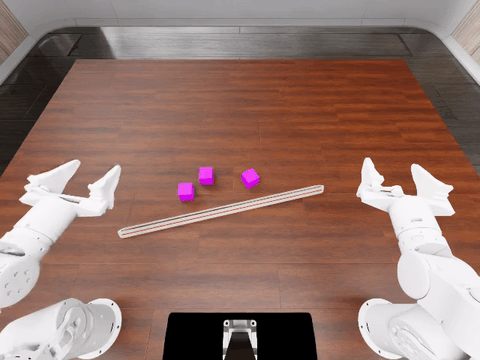

在 RoboDojo 中运行 LiteArm SE 双臂站，并由 PyRUA-Lean 代码策略驱动；面向需要可复现安装仿真器、策略服务器和机器人资产的工程师。

[English](README.md) | 简体中文

# LiteArm AI，PyRUA-Lean on RoboDojo

本仓库包含整套链路的两端。策略服务器针对 LiteArm 工具编写机器人程序；RoboDojo 客户端在 Isaac Sim 中执行这些程序。仓库提供
LiteArm 机器人资产、环境配置、评测脚本，以及官方 `stack_blocks` 运行所用的数据。

## 演示

`stack_blocks`，seed 0，参考机器：



完整视频：[stack_blocks.mp4](docs/assets/videos/stack_blocks.mp4)

`cover_blocks`，seed 0：



完整视频：[cover_blocks.mp4](docs/assets/videos/cover_blocks.mp4)

`align_blocks`，seed 0：



完整视频：[align_blocks.mp4](docs/assets/videos/align_blocks.mp4)

`stack_blocks` seed 0 在参考机器上完成，success rate 1.0、score 100、1379 步。2026-11-03 的
`align_blocks` seed 0 运行同样返回 success rate 1.0、score 100。仿真器运行于 Ubuntu 22.04 +
RTX 4060 8 GB；策略服务器运行于 Jetson AGX Thor 128 GB。以上录制来自参考机器的运行。

## 仓库内容

| 路径 | 内容 |
| --- | --- |
| `pyrua-lean/` | PyRUA-Lean 源码，包含 LiteArm 适配器和工具 |
| `robodojo/` | RoboDojo 源码，包含 LiteArm 机器人和环境配置 |
| `integrations/xpolicylab/` | XPolicyLab 子模块中未进入其上游仓库的改动 |
| `assets/litearm/` | LiteArm URDF、USD、碰撞/驱动配置和 cuRobo 模板 |
| `tools/litearm/` | 资产转换、验证和诊断脚本 |
| `scripts/` | 安装、资产、评测和分机脚本 |
| `docs/` | 安装、使用和架构文档 |

## 环境要求

- Ubuntu 22.04，x86_64。其他 Linux 发行版未验证。
- NVIDIA GPU 与较新的驱动。仿真器在本文使用的 160x120 相机分辨率下需要 8 GB 显存。策略服务器的分割模型 SAM3 还需要 5-6 GB，因此在总显存低于 16 GB 时使用两台主机，或使用至少 16 GB 的单机。
- 约 40 GB 磁盘用于 Isaac Sim 和 IsaacLab，另需数十 GB 用于 RoboDojo 资产数据集，以及 3.4 GB 用于 SAM3 检查点。
- Conda 或 Miniconda、`git`、`git-lfs`、`wget`。
- 一个 OpenAI 兼容的 chat 端点及其 API Key。仓库中不保存任何 Key。

## 单机快速开始

```bash
git clone https://github.com/nexform-tech/LiteARM-AI-PyRUA-Lean.git
cd LiteARM-AI-PyRUA-Lean
bash scripts/setup.sh
bash scripts/fetch_assets.sh
cp config/env.example.sh config/env.sh
# 编辑 config/env.sh，填入端点、Key 和模型名
bash scripts/run_eval.sh --task stack_blocks --seed 0
```

`scripts/setup.sh` 会安装两个 conda 环境，在全新主机上可能需要一小时以上。策略服务器主机使用 `--skip-sim`，仿真器主机使用
`--skip-policy`。脚本按参考机器上的步骤编写；安装脚本在全新主机上的运行尚未验证，状态见[安装](docs/setup.md)。

**不要**提交 `config/env.sh`，也不要把 Key 粘贴到 issue、日志或脚本中；该文件已被 `.gitignore` 排除。

## 分机部署

在每台主机的仓库根目录运行以下命令。

策略服务器主机：

```bash
bash scripts/setup.sh --skip-sim
bash scripts/fetch_assets.sh --policy-only
cp config/env.example.sh config/env.sh
# 编辑 config/env.sh
bash scripts/run_server.sh
```

仿真器主机：

```bash
bash scripts/setup.sh --skip-policy
bash scripts/fetch_assets.sh --skip-sam3
POLICY_HOST=192.168.1.10 bash scripts/run_client.sh
```

`scripts/fetch_assets.sh --policy-only` 只下载 SAM3 检查点。仿真器主机会下载 RoboDojo 数据集并安装
LiteArm 资产；`--skip-sam3` 让该主机不下载检查点。

## 文档

- [文档索引](docs/index.md)
- [安装](docs/setup.md)：前置条件、单机与分机安装、资产下载和验证。
- [使用](docs/usage.md)：模型配置、单机与分机评测。
- [架构](docs/architecture.md)：组件、数据流和上游版本。

## 许可

仓库自身的许可尚未确定。内置的第三方组件保留各自的上游许可，详见 [NOTICE](NOTICE)。
